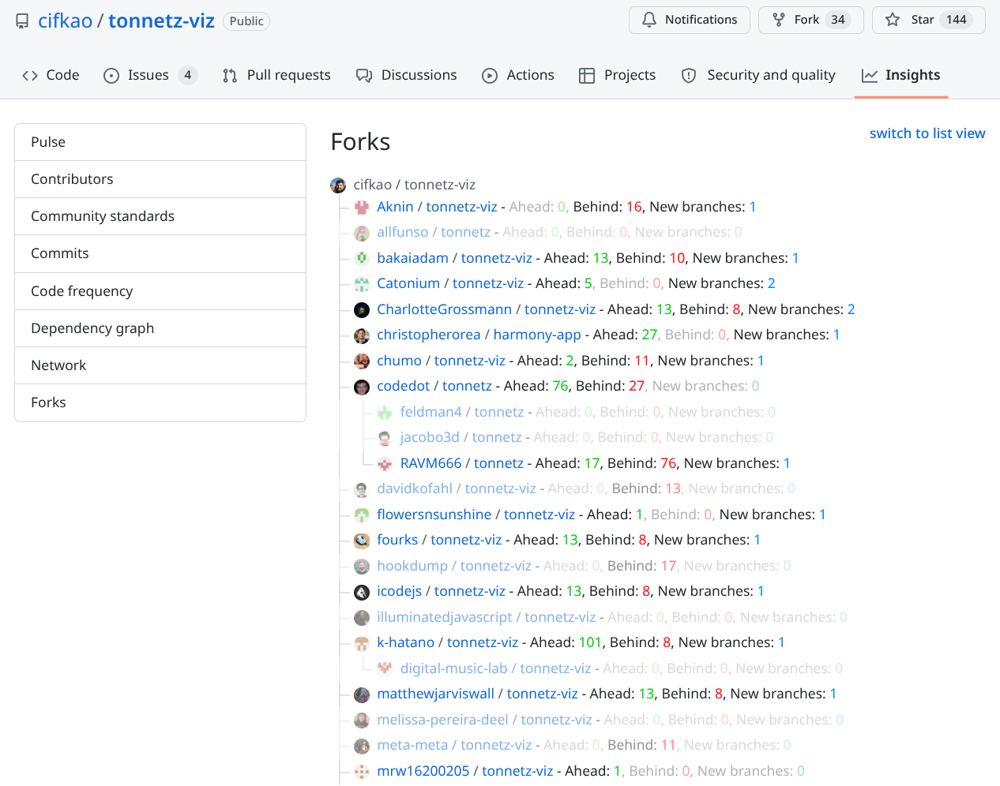

# github-fork-bookmarklet



The Github fork pages unfortunately don't show which forks are really active.

These bookmarklets retrieve this information using calls to `https://github.com/${user}/${repo}/branch-infobar/${branch}`, and update the list of forks with, for each fork:
- the number of commits **Ahead** and **Behind** the parent repo (the largest values among all its branches with `ALL_BRANCHES`, otherwise those of the default branch),
- the number of **New branches** (branches that don't exist in the parent repo), with `ALL_BRANCHES` only.

Unmodified forks (not ahead by any commit and without any new branch, so likely accidental forks) can be hidden or grayed out.
Stats equal to 0 are grayed out.

There is one bookmarklet per kind of forks page:
- [`github-forks-tree-stats`](#network-members-page-tree-view) for the network members page (`https://github.com/<user>/<repo>/network/members`), in tree view.
- [`github-forks-list-stats`](#forks-page-list-view) for the new default forks page (`https://github.com/<user>/<repo>/forks`), in list view.


## Installation / usage

1. Make a new bookmark in your browser (right-click on the bookmarks bar and click Add Page...)
2. Assign a useful name e.g. "Github Forks Stats"
3. Paste the Javascript of the bookmarklet you want (see below) as the URL
4. Visit a repo page and click the bookmark.
   If you aren't on the right forks page, the bookmarklet takes you there and carries on.
   Clicking it again later resets the previous results first.

Caveats:
- This will take some time unfortunately.
- Rate limit: `https://api.github.com` is limited to 60 requests per hour when unauthenticated, and only the default branch lookups use it.

  A run costs:
  - 1 request per run
  - 1 request per fork line, if branch can't be found under the main repo's default branch name (typically a fork with another default branch).

  The other requests go to `https://github.com` (not covered by that limit, but too many too fast may still get throttled):
  per fork line:
  - 1 `branch-infobar` request for the default branch
  - 1 `refs` request, if `ALL_BRANCHES` is on, plus 1 per distinct parent repo that is not the main repo (tree view)
  - 1 more `branch-infobar` request per other branch of the fork, if `ALL_BRANCHES` is on (there is no cap)


## Options

The options are the default parameters on the very first line of each bookmarklet.
Edit their value in the bookmark to change them.

| Option | Default | Description |
| --- | --- | --- |
| `HIDE_UNMODIFIED` | `false` | Unmodified forks (no commit ahead, no new branch): `true` hides them, `false` grays them out. |
| `ALL_BRANCHES` | `true` | Fetch all the branches of each fork, instead of only the default branch. Ahead and Behind become the largest values among all the branches (hover to see which branch), and the number of new branches (that don't exist in the parent repo) is displayed. If `false`, only the default branch is considered, and new branches are ignored when deciding if a fork is unmodified. |
| `MAX_FORKS` | `Infinity` | Debug: only process this many forks, to spare the API rate limit. Use `Infinity` for no limit. |


## Network members page (tree view)

An unmodified fork that has a modified downstream fork (a fork nested under it in the tree) is never hidden, only grayed out, so that the modified fork stays reachable.
With `MAX_FORKS`, the downstream forks that are not processed are considered unmodified.

```js
javascript:(async (HIDE_UNMODIFIED=false, ALL_BRANCHES=true, MAX_FORKS=Infinity) => {
    /*
      Source: github.com/cryhot/github-fork-bookmarklet
      Purpose: On the network members page of a GitHub repo (tree view), show for each fork how far it is from its parent (ahead, behind, new branches), and hide or gray out the unmodified forks.
      Options are documented in the README.
    */

    /* Ensure the script is run on a valid GitHub repository page, and go to the forks page if needed */
    const ensureForksPage = async () => {
        const match = window.location.href.match(/^https:\/\/github\.com\/([^/]+)\/([^/]+)(\/network\/members\/?)?/);
        if (!match) {
            alert('Run this from a GitHub repository page.');
            throw new Error('Not on a valid GitHub repository page.');
        }
        if (!match[3]) {
            const forksUrl = `https://github.com/${match[1]}/${match[2]}/network/members`;
            if (!window.Turbo) {
                window.location.href = forksUrl;
                throw new Error('Redirecting to the forks page.');
            }
            /* Keep running once the forks page is loaded */
            const loaded = new Promise((resolve) => document.addEventListener('turbo:load', resolve, { once: true }));
            window.Turbo.visit(forksUrl);
            await loaded;
        }
        return { user: match[1], repo: match[2] };
    };

    /* Fetch the default branch of a repository */
    const getDefaultBranch = async (user, repo) => {
        const response = await fetch(`https://api.github.com/repos/${user}/${repo}`);
        if (!response.ok) throw new Error('Failed to retrieve repository information.');
        return (await response.json()).default_branch;
    };

    /* Fetch branch information of a repository (null on failure) */
    const getBranchInfo = async (user, repo, branch) => {
        try {
            const response = await fetch(`https://github.com/${user}/${repo}/branch-infobar/${branch}`, { headers: { accept: 'application/json' } });
            return response.ok ? (await response.json()).refComparison : null;
        } catch (error) {
            console.error(`Error fetching branch info for ${user}/${repo}:`, error);
            return null;
        }
    };

    /* Fetch the branch names of a repository (null on failure) */
    const getBranches = async (user, repo) => {
        try {
            const response = await fetch(`https://github.com/${user}/${repo}/refs?type=branch`, { headers: { accept: 'application/json' } });
            return response.ok ? (await response.json()).refs : null;
        } catch (error) {
            console.error(`Error fetching branches for ${user}/${repo}:`, error);
            return null;
        }
    };

    /* Fetch the branch names of the parent repos (cached by lowercase name) */
    const parentBranchesCache = new Map();
    const getParentBranches = async (parent) => {
        const key = parent.toLowerCase();
        if (!parentBranchesCache.has(key)) {
            const [parentUser, parentRepo] = parent.split('/');
            parentBranchesCache.set(key, new Set(await getBranches(parentUser, parentRepo) || []));
        }
        return parentBranchesCache.get(key);
    };

    /* Fetch the stats of a fork: the largest ahead and behind among its branches, and its branches that do not exist in its parent repo */
    const getForkStats = async (user, repo, defaultBranch) => {
        /* Attempt to fetch branch information, with fallback to the fork's default branch */
        let branchName = defaultBranch;
        let branchInfo = await getBranchInfo(user, repo, branchName);
        if (!branchInfo) {
            branchName = await getDefaultBranch(user, repo);
            branchInfo = await getBranchInfo(user, repo, branchName);
        }
        if (!branchInfo) return null;

        /* The default branch is already fetched, and its parent repo is given by the comparison base (like ahead and behind) */
        const infos = [{ name: branchName, ...branchInfo }];
        const newBranches = [];
        if (ALL_BRANCHES) {
            const forkBranches = await getBranches(user, repo) || [];
            const parentBranches = await getParentBranches(branchInfo.baseBranch.split(':')[0]);
            for (const name of forkBranches) {
                if (!parentBranches.has(name)) newBranches.push(name);
                if (name === branchName) continue;
                const info = await getBranchInfo(user, repo, name.split('/').map(encodeURIComponent).join('/'));
                if (info) infos.push({ name, ...info });
            }
        }
        const largest = (key) => infos.reduce((best, info) => info[key] > best[key] ? info : best, infos[0]);
        return { newBranches, maxAhead: largest('ahead'), maxBehind: largest('behind') };
    };

    /* A fork is modified if it is ahead or has new branches */
    const isModified = ({ newBranches, maxAhead }) => maxAhead.ahead > 0 || newBranches.length > 0;

    /* Escape a text to put it in an HTML attribute */
    const escapeHtml = (text) => text.replace(/["<&]/g, (c) => `&#${c.charCodeAt(0)};`);

    /* Format the stats of a fork; a zero is faded with opacity so it works in light and dark modes, and so is a comma next to a zero */
    const formatForkStats = ({ newBranches, maxAhead, maxBehind }) => [
        ['Ahead', maxAhead.ahead, '#0c0', maxAhead.ahead > 0 ? escapeHtml(maxAhead.name) : ''],
        ['Behind', maxBehind.behind, 'red', maxBehind.behind > 0 ? escapeHtml(maxBehind.name) : ''],
        ...(ALL_BRANCHES ? [['New branches', newBranches.length, '#08f', escapeHtml(newBranches.join(', '))]] : [])
    ].map(([label, value, color, title], i, stats) => {
        const comma = i > 0 ? `<span style="opacity: ${value === 0 || stats[i - 1][1] === 0 ? 0.35 : 1}">, </span>` : '';
        return `${comma}<span style="opacity: ${value === 0 ? 0.35 : 1}" title="${title}">${label}: <font color="${color}">${value}</font></span>`;
    }).join('');

    try {
        /* Ensure on the forks page and get main repository details */
        const { user: mainUser, repo: mainRepo } = await ensureForksPage();

        /* Reset the results of a previous run */
        document.querySelectorAll('.fork-stats').forEach((el) => el.remove());
        const rows = [...document.querySelectorAll('div.repo')];
        rows.forEach((el) => { el.style.display = ''; el.style.opacity = ''; el.style.boxShadow = ''; });

        const defaultBranch = await getDefaultBranch(mainUser, mainRepo);

        /* The first row is the original repo; the depth in the tree is the number of tree icons */
        const depth = (row) => row.querySelectorAll('.network-tree').length;
        const stats = new Map();

        /* Fetch the stats of each fork */
        for (const row of rows.slice(1, 1 + MAX_FORKS)) {
            const link = row.querySelector('a:last-of-type');

            /* Show a halo on the fork being fetched */
            row.style.boxShadow = '0 0 8px 2px gold';
            try {
                const [_, user, repo] = link.href.match(/github\.com\/([^/]+)\/([^/]+)/) || [];
                if (!user || !repo) continue;
                const stat = await getForkStats(user, repo, defaultBranch);
                if (stat) stats.set(row, { link, ...stat });
            } catch (error) {
                console.error(`Error processing link: ${link?.href}`, error);
            } finally {
                row.style.boxShadow = '';
            }
        }

        /* Downstream forks are the following rows that are deeper in the tree */
        const hasModifiedDownstream = (index) => {
            for (let i = index + 1; i < rows.length && depth(rows[i]) > depth(rows[index]); i++) {
                if (stats.has(rows[i]) && isModified(stats.get(rows[i]))) return true;
            }
            return false;
        };

        /* Hide or show branch details for forks based on modifications */
        rows.forEach((row, index) => {
            const stat = stats.get(row);
            if (!stat) return;
            const isUnmodified = !isModified(stat);

            /* An unmodified fork is not hidden if it has a modified downstream fork, only grayed out */
            if (isUnmodified && HIDE_UNMODIFIED && !hasModifiedDownstream(index)) {
                row.style.display = 'none';
            } else {
                stat.link.insertAdjacentHTML('afterend', `<span class="fork-stats"> - ${formatForkStats(stat)}</span>`);
                if (isUnmodified) row.style.opacity = 0.5;
            }
        });
    } catch (error) {
        console.error('Error in bookmarklet execution:', error);
    }
})();
```
Raw script in [`github-forks-tree-stats.js`](github-forks-tree-stats.js).


## Forks page (list view)

Caveat: the forks page is paginated so you will only see a couple of entries at a time.

```js
javascript:(async (HIDE_UNMODIFIED=false, ALL_BRANCHES=true, MAX_FORKS=Infinity) => {
    /*
      Source: github.com/cryhot/github-fork-bookmarklet
      Purpose: On the forks page of a GitHub repo (list view), show for each fork how far it is from its parent (ahead, behind, new branches), and hide or gray out the unmodified forks.
      Options are documented in the README.
    */

    /* Ensure the script is run on a valid GitHub repository page, and go to the forks page if needed */
    const ensureForksPage = async () => {
        const match = window.location.href.match(/^https:\/\/github\.com\/([^/]+)\/([^/]+)(\/forks\/?)?/);
        if (!match) {
            alert('Run this from a GitHub repository page.');
            throw new Error('Not on a valid GitHub repository page.');
        }
        if (!match[3]) {
            const forksUrl = `https://github.com/${match[1]}/${match[2]}/forks`;
            if (!window.Turbo) {
                window.location.href = forksUrl;
                throw new Error('Redirecting to the forks page.');
            }
            /* Keep running once the forks page is loaded */
            const loaded = new Promise((resolve) => document.addEventListener('turbo:load', resolve, { once: true }));
            window.Turbo.visit(forksUrl);
            await loaded;
        }
        return { user: match[1], repo: match[2] };
    };

    /* Fetch the default branch of a repository */
    const getDefaultBranch = async (user, repo) => {
        const response = await fetch(`https://api.github.com/repos/${user}/${repo}`);
        if (!response.ok) throw new Error('Failed to retrieve repository information.');
        return (await response.json()).default_branch;
    };

    /* Fetch branch information of a repository (null on failure) */
    const getBranchInfo = async (user, repo, branch) => {
        try {
            const response = await fetch(`https://github.com/${user}/${repo}/branch-infobar/${branch}`, { headers: { accept: 'application/json' } });
            return response.ok ? (await response.json()).refComparison : null;
        } catch (error) {
            console.error(`Error fetching branch info for ${user}/${repo}:`, error);
            return null;
        }
    };

    /* Fetch the branch names of a repository (null on failure) */
    const getBranches = async (user, repo) => {
        try {
            const response = await fetch(`https://github.com/${user}/${repo}/refs?type=branch`, { headers: { accept: 'application/json' } });
            return response.ok ? (await response.json()).refs : null;
        } catch (error) {
            console.error(`Error fetching branches for ${user}/${repo}:`, error);
            return null;
        }
    };

    /* Fetch the branch names of the parent repos (cached by lowercase name) */
    const parentBranchesCache = new Map();
    const getParentBranches = async (parent) => {
        const key = parent.toLowerCase();
        if (!parentBranchesCache.has(key)) {
            const [parentUser, parentRepo] = parent.split('/');
            parentBranchesCache.set(key, new Set(await getBranches(parentUser, parentRepo) || []));
        }
        return parentBranchesCache.get(key);
    };

    /* Fetch the stats of a fork: the largest ahead and behind among its branches, and its branches that do not exist in its parent repo */
    const getForkStats = async (user, repo, defaultBranch) => {
        /* Attempt to fetch branch information, with fallback to the fork's default branch */
        let branchName = defaultBranch;
        let branchInfo = await getBranchInfo(user, repo, branchName);
        if (!branchInfo) {
            branchName = await getDefaultBranch(user, repo);
            branchInfo = await getBranchInfo(user, repo, branchName);
        }
        if (!branchInfo) return null;

        /* The default branch is already fetched, and its parent repo is given by the comparison base (like ahead and behind) */
        const infos = [{ name: branchName, ...branchInfo }];
        const newBranches = [];
        if (ALL_BRANCHES) {
            const forkBranches = await getBranches(user, repo) || [];
            const parentBranches = await getParentBranches(branchInfo.baseBranch.split(':')[0]);
            for (const name of forkBranches) {
                if (!parentBranches.has(name)) newBranches.push(name);
                if (name === branchName) continue;
                const info = await getBranchInfo(user, repo, name.split('/').map(encodeURIComponent).join('/'));
                if (info) infos.push({ name, ...info });
            }
        }
        const largest = (key) => infos.reduce((best, info) => info[key] > best[key] ? info : best, infos[0]);
        return { newBranches, maxAhead: largest('ahead'), maxBehind: largest('behind') };
    };

    /* A fork is modified if it is ahead or has new branches */
    const isModified = ({ newBranches, maxAhead }) => maxAhead.ahead > 0 || newBranches.length > 0;

    /* Escape a text to put it in an HTML attribute */
    const escapeHtml = (text) => text.replace(/["<&]/g, (c) => `&#${c.charCodeAt(0)};`);

    /* Format the stats of a fork; a zero is faded with opacity so it works in light and dark modes, and so is a comma next to a zero */
    const formatForkStats = ({ newBranches, maxAhead, maxBehind }) => [
        ['Ahead', maxAhead.ahead, '#0c0', maxAhead.ahead > 0 ? escapeHtml(maxAhead.name) : ''],
        ['Behind', maxBehind.behind, 'red', maxBehind.behind > 0 ? escapeHtml(maxBehind.name) : ''],
        ...(ALL_BRANCHES ? [['New branches', newBranches.length, '#08f', escapeHtml(newBranches.join(', '))]] : [])
    ].map(([label, value, color, title], i, stats) => {
        const comma = i > 0 ? `<span style="opacity: ${value === 0 || stats[i - 1][1] === 0 ? 0.35 : 1}">, </span>` : '';
        return `${comma}<span style="opacity: ${value === 0 ? 0.35 : 1}" title="${title}">${label}: <font color="${color}">${value}</font></span>`;
    }).join('');

    try {
        /* Ensure on the forks page and get main repository details */
        const { user: mainUser, repo: mainRepo } = await ensureForksPage();

        /* Reset the results of a previous run */
        document.querySelectorAll('.fork-stats').forEach((el) => el.remove());
        const forks = [...document.querySelectorAll('ul[data-view-component="true"] > li.Box-row')];
        forks.forEach((el) => { el.style.display = ''; el.style.opacity = ''; el.style.boxShadow = ''; });

        const defaultBranch = await getDefaultBranch(mainUser, mainRepo);

        /* Fetch the stats of each fork */
        for (const fork of forks.slice(0, MAX_FORKS)) {
            const repoLink = fork.querySelector('a[href*="/"]:nth-of-type(2)');

            /* Show a halo on the fork being fetched */
            fork.style.boxShadow = '0 0 8px 2px gold';
            try {
                const [_, user, repo] = repoLink?.href.match(/github\.com\/([^/]+)\/([^/]+)/) || [];
                if (!user || !repo) continue;
                const stat = await getForkStats(user, repo, defaultBranch);
                if (!stat) continue;

                /* Hide or show branch details for forks based on modifications */
                const isUnmodified = !isModified(stat);
                if (isUnmodified && HIDE_UNMODIFIED) {
                    fork.style.display = 'none';
                } else {
                    const infoDiv = document.createElement('div');
                    infoDiv.className = 'fork-stats';
                    infoDiv.innerHTML = formatForkStats(stat);
                    infoDiv.style.marginTop = '10px';
                    infoDiv.style.fontSize = 'small';
                    fork.appendChild(infoDiv);
                    if (isUnmodified) fork.style.opacity = 0.5;
                }
            } catch (error) {
                console.error(`Error processing link: ${repoLink?.href}`, error);
            } finally {
                fork.style.boxShadow = '';
            }
        }
    } catch (error) {
        console.error('Error in bookmarklet execution:', error);
    }
})();
```
Raw script in [`github-forks-list-stats.js`](github-forks-list-stats.js).


## Changelog

- 2026-10-02: Split into two sibling bookmarklets (tree and list view), with new features:
  - no second click after the redirect,
  - a reset on re-run,
  - zeros grayed out,
  - a visual clue when fetching the forks (which might take a while),
  - the `ALL_BRANCHES` option: **Ahead** and **Behind** as the largest values among all the branches (instead of the default branch only), along with the **New branches** stat (relative to the parent repo),
  - the `HIDE_UNMODIFIED` and `MAX_FORKS` options,
  - with `HIDE_UNMODIFIED`, do not hide an unmodified fork if it has a modified downstream fork in the tree.
- 2024-11-22: Fix #1 - supports repos with master branch.
- 2024-11-22: initial release


## References

The idea for this bookmarket originated from this [stackoverflow discussion](https://stackoverflow.com/questions/54868988/how-to-determine-which-forks-on-github-are-ahead) and in particular [this solution by user 'root'](https://stackoverflow.com/a/68335748/278842), which broke when Github made the branch information async.
